<div align="center">


# NEXUS OS

**Dein ganzer Windows-PC in einem Dashboard.**

Live-Monitor · Automationen · File Converter · Speedtest · Workspaces · 5 Themes<br>
alles in **einer einzigen Python-Datei**, ohne eine einzige externe Abhängigkeit.

[](#-installation)
[](https://www.python.org/downloads/)
[](#%EF%B8%8F-technik)
[](#-sicherheit--datenschutz)
[](LICENSE)

<br>

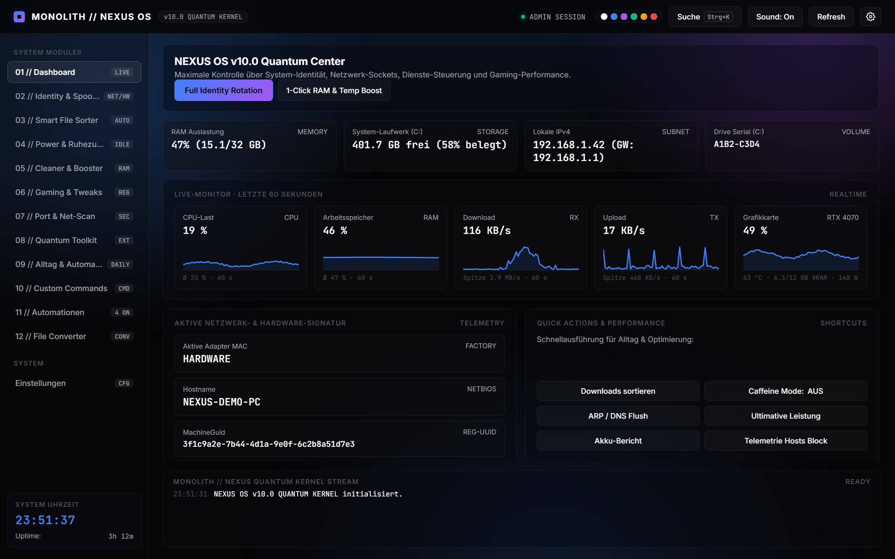

<sub>Dashboard im Look „Midnight · Glas · Aurora · Farbverlauf“, einer von unzähligen Kombinationen</sub>

<br><br>

[Highlights](#-highlights) ·
[Screenshots](#-screenshots) ·
[Features](#-alle-features) ·
[Installation](#-installation) ·
[Design teilen](#-design-teilen) ·
[FAQ](#-faq)

</div>

---

## 🔥 Highlights

<table>
  <tr>
    <td width="33%" valign="top">
      <h3>⚡ Automationen</h3>
      „Wenn <code>valorant.exe</code> startet → Höchstleistung an.“<br>
      Auslöser: Programmstart/-ende, Uhrzeit, Intervall, App-Start. Ganz ohne Skripten.
    </td>
    <td width="33%" valign="top">
      <h3>🎨 Komplett anpassbar</h3>
      5 Themes inkl. Light Mode, Glas-Karten, Aurora-Hintergrund, Farbverläufe, Schriften, Animationen und mehr.
      Teile deinen Look per <b>Design-Code</b>.
    </td>
    <td width="33%" valign="top">
      <h3>🗂️ File Converter</h3>
      HEIC → JPG, Bilder → PDF, PNG → ICO, Clips für Discord <b>unter 10 MB</b>, Video → MP3, CSV ↔ JSON.
    </td>
  </tr>
  <tr>
    <td width="33%" valign="top">
      <h3>📈 Live-Monitor</h3>
      CPU, RAM, Download, Upload und <b>GPU</b> (Last, Temperatur, VRAM, Watt) als Echtzeit-Graphen mit Hover-Details.
    </td>
    <td width="33%" valign="top">
      <h3>🌐 Netz-Diagnose</h3>
      Speedtest, Ping-Monitor mit Jitter &amp; Paketverlust, offene Ports, Port-Scanner, DNS-Benchmark.
    </td>
    <td width="33%" valign="top">
      <h3>⌨️ Strg + K</h3>
      Eine Suche für alles: Workspaces starten, Befehle ausführen, Rechner (<code>12*3+4</code>), Google- &amp; YouTube-Suche.
    </td>
  </tr>
</table>

---

## 📸 Screenshots

<table>
  <tr>
    <td width="50%">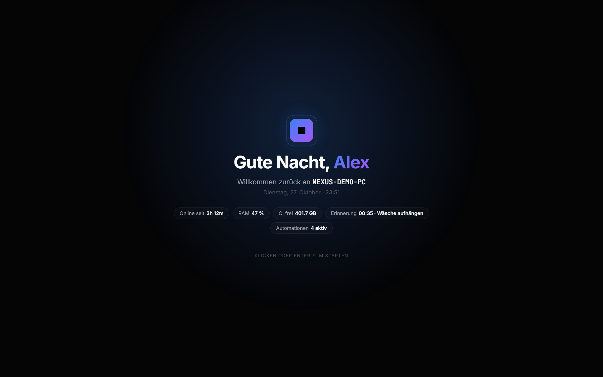<br><sub><b>Welcome-Screen</b>: begrüßt dich mit Namen und PC-Namen</sub></td>
    <td width="50%">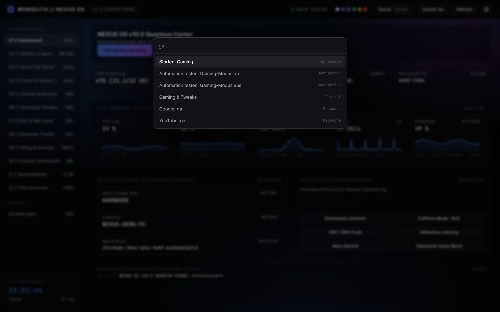<br><sub><b>Strg + K</b>: Befehlssuche für alles</sub></td>
  </tr>
  <tr>
    <td width="50%">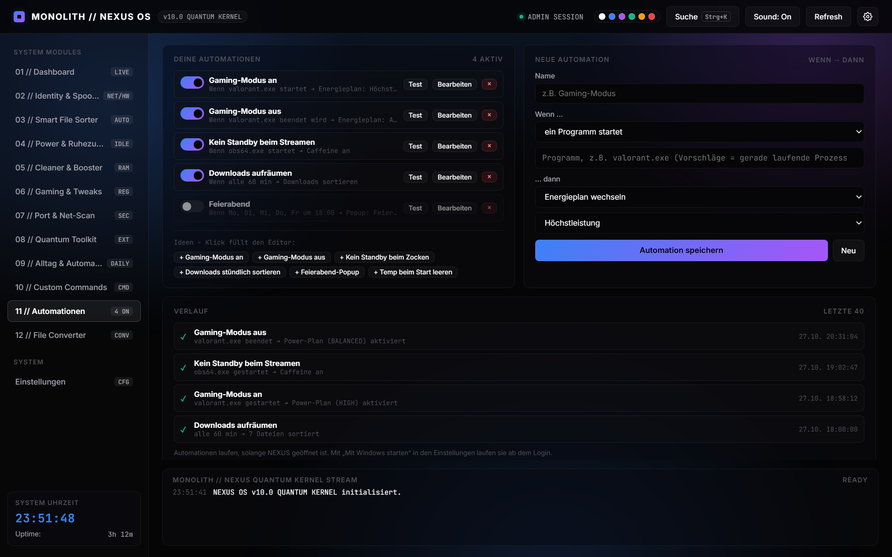<br><sub><b>Automationen</b>: Wenn X, dann Y, inklusive Verlauf</sub></td>
    <td width="50%">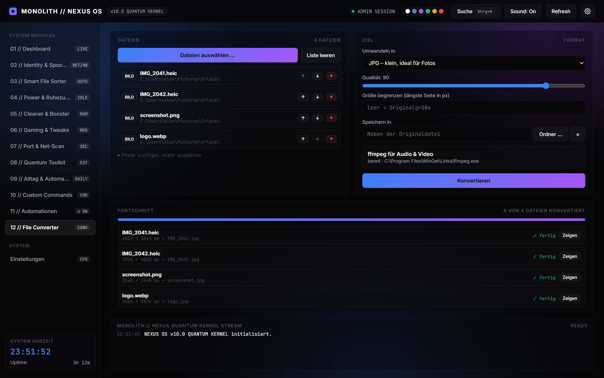<br><sub><b>File Converter</b>: Bilder, PDF, Video, Audio, Daten</sub></td>
  </tr>
  <tr>
    <td width="50%">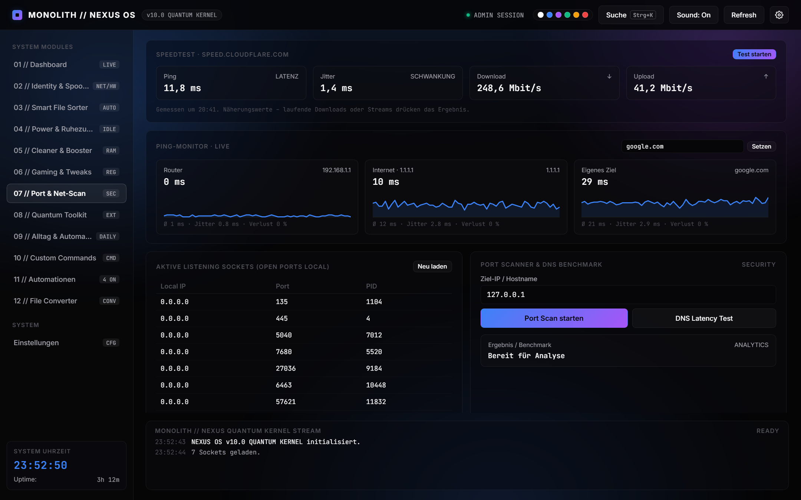<br><sub><b>Netz-Scan</b>: Speedtest, Ping-Monitor, offene Ports</sub></td>
    <td width="50%">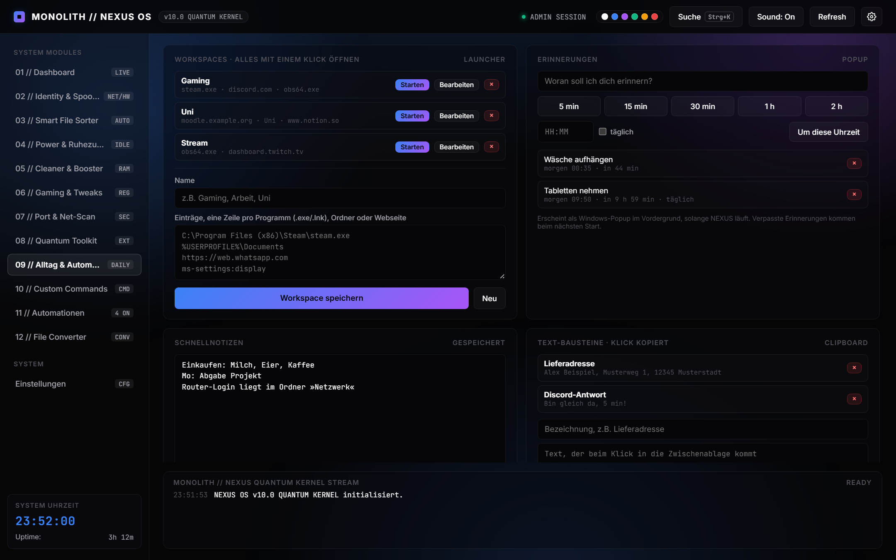<br><sub><b>Alltag</b>: Workspaces, Erinnerungen, Notizen, Text-Bausteine</sub></td>
  </tr>
  <tr>
    <td width="50%">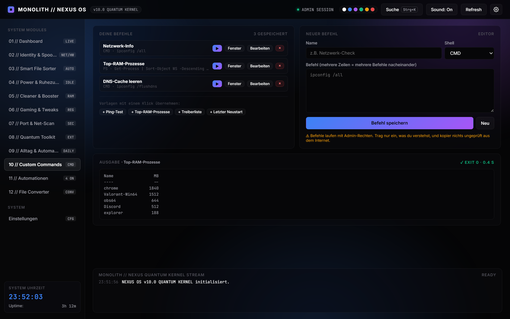<br><sub><b>Custom Commands</b>: eigene CMD-/PowerShell-Befehle mit Ausgabe</sub></td>
    <td width="50%">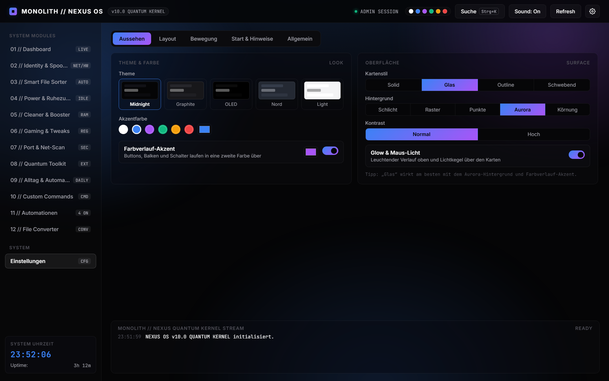<br><sub><b>Einstellungen</b>: 5 Tabs voller Design-Optionen</sub></td>
  </tr>
</table>

### 🎨 Ein Tool, viele Looks

<table>
  <tr>
    <td width="33%">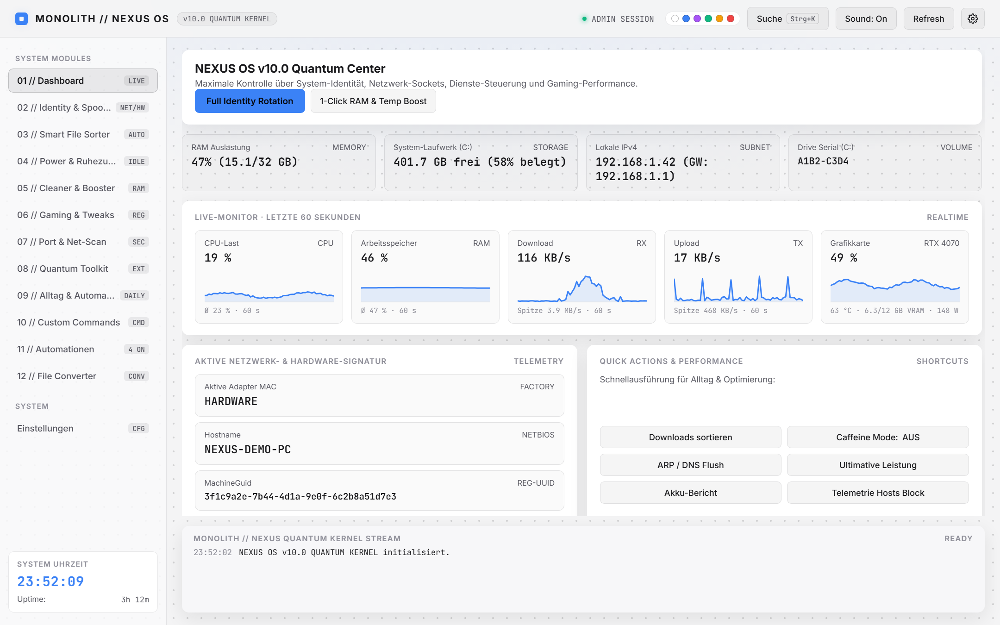<br><sub><b>Light</b> · Schwebende Karten · Punkte</sub></td>
    <td width="33%">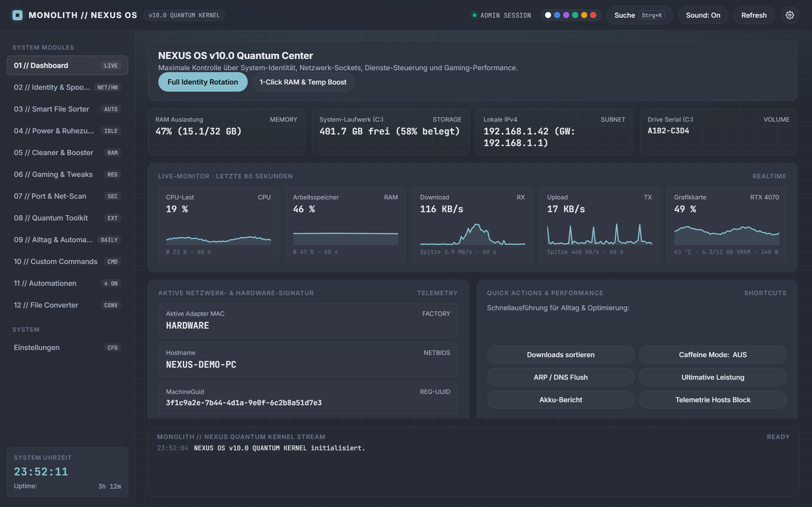<br><sub><b>Nord</b> · Raster · Pill-Buttons</sub></td>
    <td width="33%">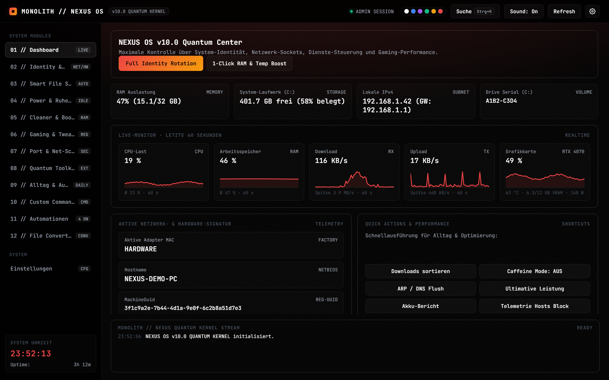<br><sub><b>OLED</b> · Outline · Körnung · Mono-Schrift</sub></td>
  </tr>
</table>

<sub>Alle Screenshots zeigen Demo-Daten.</sub>

---

## 🧩 Alle Features

<details open>
<summary><b>📊 Dashboard & Live-Monitor</b></summary>

- Echtzeit-Graphen der letzten 60 Sekunden für **CPU, RAM, Download, Upload und GPU** (NVIDIA: Last, Temperatur, VRAM, Leistung)
- Fahr mit der Maus über einen Graphen und du siehst den Wert zu jeder Sekunde
- RAM, freier Speicher, IP und Gateway auf einen Blick
- Schnellaktionen und **Workspace-Buttons** direkt auf dem Dashboard
- Bereiche einzeln ein- und ausblendbar
</details>

<details>
<summary><b>⚡ Automationen</b></summary>

- **Auslöser:** Programm startet oder wird beendet · Uhrzeit an bestimmten Wochentagen · alle X Minuten · beim Start von NEXUS
- **Aktionen:** Energieplan wechseln · Caffeine (kein Standby) an/aus · Workspace öffnen · Custom Command ausführen · Popup zeigen · Downloads sortieren · Temp bereinigen
- Vorlagen wie „Gaming-Modus an/aus“ oder „Downloads stündlich sortieren“ füllen den Editor mit einem Klick
- Laufende Prozesse werden beim Eintippen vorgeschlagen
- Test-Knopf und Verlauf mit Ergebnis jeder Ausführung
</details>

<details>
<summary><b>🗂️ File Converter</b></summary>

| Ziel | aus | Extras |
|---|---|---|
| PNG · JPG · BMP · TIFF · GIF | PNG, JPG, HEIC, WebP, BMP, TIFF, GIF, ICO … | Qualität, Größe begrenzen, EXIF-Drehung, Transparenz → Weiß bei JPG |
| **PDF** | beliebig viele Bilder | jede Datei eine A4-Seite, Reihenfolge per ↑ ↓ |
| **ICO** | jedes Bild | 256 × 256, quadratisch eingepasst |
| **MP4 für Discord** | Videos | Bitrate wird aus der Länge berechnet → unter 10 MB |
| MP4 · GIF | Videos | 3 Qualitätsstufen, animiertes GIF mit Palette |
| MP3 · M4A · WAV · FLAC · OGG | Audio & Videos | Tonspur aus Videos ziehen |
| CSV ↔ JSON | Daten | CSV öffnet sich direkt richtig in deutschem Excel |

Bilder laufen über die in Windows eingebauten Codecs (WPF/WIC). Für Audio und Video wird ffmpeg gebraucht; die Installation per winget ist ein Klick im Tool. Originale werden **nie** überschrieben.
</details>

<details>
<summary><b>🌐 Port & Net-Scan</b></summary>

- **Speedtest** über speed.cloudflare.com: Ping, Jitter, Download und Upload mit Live-Anzeige
- **Ping-Monitor** für Router, Internet und ein eigenes Ziel (z.B. Spielserver), mit Durchschnitt, Jitter und Paketverlust
- Offene Listening-Ports, Port-Scanner und DNS-Latenz-Vergleich
</details>

<details>
<summary><b>☀️ Alltag & Automatik</b></summary>

- **Workspaces:** Programme, Ordner, Webseiten und `ms-settings:`-Links mit einem Klick öffnen (starten ohne Admin-Rechte)
- **Erinnerungen** als Windows-Popup, einmalig oder täglich; verpasste Erinnerungen kommen beim nächsten Start
- **Fokus-Timer** (25/50 min, Pause), **Schnellnotizen** mit Auto-Save, **Text-Bausteine** per Klick in die Zwischenablage
- **Schnellordner:** AppData, Temp, Autostart-Ordner, hosts-Datei (öffnet mit Admin-Rechten)
</details>

<details>
<summary><b>🧹 Dateien, Cleaner & Tweaks</b></summary>

- **Smart File Sorter** mit Vorschau, Rückgängig und **Auto-Sortierung** im Hintergrund (laufende Downloads bleiben liegen)
- **Duplikat-Finder** per Hash, Kopien landen nur im Papierkorb
- **Speicherfresser-Analyse** und Large-File-Radar
- **Massen-Umbenennen** mit Mustern wie `Urlaub_{n}` oder `{date}_{name}`, inkl. Vorschau und Rückgängig
- Temp-/Prefetch-/Thumbnail-Cleaner, RAM-Trim
- Registry-Tweaks (klassisches Kontextmenü, Bing-Suche aus, GameDVR aus …), Prozess-Priorität, **Autostart-Manager** mit An/Aus-Schaltern
</details>

<details>
<summary><b>🧰 Toolkit, Commands & Power</b></summary>

- **App-Updates per winget:** alle Updates auf einen Blick, einzeln oder alle auf einmal installieren
- **Systeminfo** zum Kopieren (CPU, GPU, RAM, Windows-Build, Laufwerke) und **Festplatten-Gesundheit**
- **Custom Commands:** eigene CMD-/PowerShell-Befehle speichern, ausführen, Ausgabe direkt sehen
- Shutdown-/Neustart-/Ruhezustand-Timer, Energiepläne, Caffeine-Modus, Akku-Bericht
- **Netzwerk-Identität:** MAC-Adresse und Hostname ändern (z.B. für mehr Privatsphäre in öffentlichen WLANs), DNS-Anbieter wechseln. Alle Originalwerte werden beim ersten Start gesichert und lassen sich mit einem Klick wiederherstellen.
</details>

<details>
<summary><b>🎨 Design & Komfort</b></summary>

- **Aussehen:** Midnight, Graphite, OLED, Nord, Light · Akzentfarbe + Farbverlauf · Kartenstil Solid / Glas / Outline / Schwebend · Hintergrund Raster / Punkte / Aurora / Körnung · hoher Kontrast
- **Layout:** 5 Schriftarten, 5 Größen, Ecken, Pill-Buttons, Abstände, Seitenleiste links oder rechts, Breite, Scrollbalken
- **Bewegung:** Seitenübergänge Pop / Slide / Zoom / Blur, Tempo, schwebende Karten
- **Start & Hinweise:** Welcome-Screen, Toast-Benachrichtigungen (Position, Dauer), 12/24-h-Uhr
- Eigener App-Name, Module ausblenden, Startansicht, **Mit Windows starten** (ohne UAC-Abfrage)
- Moderne Dialoge statt Browser-Popups, Backup & Import aller Daten
</details>

---

## 🚀 Installation

**Voraussetzungen**

| Was | Details |
|---|---|
| System | Windows 10 oder 11 |
| Python | 3.11 oder neuer ([python.org](https://www.python.org/downloads/), beim Setup „Add to PATH“ anhaken) |
| Browser | Edge (bei Windows dabei), Chrome oder Brave: das Fenster öffnet sich als eigene App |
| Optional | winget (bei Windows 11 dabei) für App-Updates · ffmpeg für Audio/Video (Ein-Klick-Installation im Tool) · NVIDIA-Treiber für die GPU-Kachel |

**Starten**

```powershell
git clone https://github.com/BIGpapadoggy69/nexus-os.git
cd nexus-os
python nexus123.py
```

Oder einfach oben auf **Code → Download ZIP** klicken, entpacken und `nexus123.py` doppelklicken.

Windows fragt einmal nach Admin-Rechten (die braucht das Tool für Registry- und Netzwerk-Einstellungen), dann öffnet sich NEXUS OS in einem eigenen Fenster. Keine Installation, kein `pip install`, nichts.

> [!TIP]
> Unter **Einstellungen → Allgemein → Mit Windows starten** läuft NEXUS ab dem Login automatisch. Dann greifen auch Erinnerungen, Auto-Sortierung und Automationen den ganzen Tag.

---

## 🎨 Design teilen

Jeder Look lässt sich als kurzer Code teilen:

1. **Einstellungen → Allgemein → Personalisieren & Teilen**
2. Auf **Kopieren** klicken und den `NEXUS-…`-Code an Freunde schicken
3. Die fügen ihn bei **„Design-Code eines Freundes“** ein, klicken auf **Übernehmen** und haben sofort denselben Look

Mitgeschickt werden nur Design-Einstellungen. Name, Module und persönliche Daten bleiben bei dir.

---

## ⌨️ Tastenkürzel

| Kürzel | Aktion |
|---|---|
| <kbd>Strg</kbd> + <kbd>K</kbd> | Befehlssuche öffnen/schließen |
| <kbd>↑</kbd> <kbd>↓</kbd> <kbd>Enter</kbd> | In der Suche auswählen und ausführen |
| <kbd>Enter</kbd> / <kbd>Esc</kbd> | Dialog bestätigen / abbrechen |
| <kbd>Enter</kbd> | Welcome-Screen überspringen |

In der Suche funktionieren außerdem Rechnungen (`=2^10/4`) und Websuchen: einfach lostippen.

---

## 🔒 Sicherheit & Datenschutz

- Die Oberfläche läuft **nur lokal** auf `127.0.0.1` mit zufälligem Port, nichts ist aus dem Netzwerk erreichbar.
- Jeder Start erzeugt einen **geheimen Token**. Fremde Webseiten können die API deshalb nicht ansprechen, ein Host-Check blockt DNS-Rebinding.
- Alle Eingaben werden geprüft, bevor sie in PowerShell- oder Registry-Befehlen landen.
- **Keine Telemetrie, keine Cloud, kein Account.** Ins Internet geht das Tool nur für Schriftarten (Google Fonts), den Speedtest (Cloudflare), Pings sowie winget/ffmpeg, wenn du sie benutzt.

**Wo liegen meine Daten?**

| Datei | Inhalt |
|---|---|
| `%APPDATA%\NexusOS\user_data.json` | Workspaces, Erinnerungen, Notizen, Bausteine, Befehle, Automationen, Einstellungen |
| `%PROGRAMDATA%\NexusOS\original_ids.json` | Gesicherte Original-Werte für „Alles auf Original“ |

> [!WARNING]
> Notizen und Text-Bausteine liegen als Klartext auf der Platte, also bitte keine Passwörter speichern. **Custom Commands laufen mit Admin-Rechten:** Füge nur Befehle ein, die du verstehst.

---

## ❓ FAQ

<details>
<summary><b>Es öffnet sich kein Fenster.</b></summary>

NEXUS sucht Brave, Edge und Chrome. Falls keiner gefunden wird, wird Edge über den Windows-Befehl gestartet. Prüfe, ob einer der Browser installiert ist.
</details>

<details>
<summary><b>HEIC- oder WebP-Bilder lassen sich nicht konvertieren.</b></summary>

Windows braucht dafür die kostenlosen Erweiterungen **„HEIF-Bilderweiterungen“** bzw. **„WebP-Bilderweiterungen“** aus dem Microsoft Store.
</details>

<details>
<summary><b>Die GPU-Kachel fehlt.</b></summary>

Die Werte kommen von `nvidia-smi`, das mit dem NVIDIA-Treiber installiert wird. Bei AMD- und Intel-Grafik wird die Kachel ausgeblendet.
</details>

<details>
<summary><b>Beim Router-Ping steht „keine Antwort“.</b></summary>

Viele Router ignorieren Pings, und VPNs (z.B. Mullvad) sperren oft das lokale Netz. Das ist kein Fehler des Tools.
</details>

<details>
<summary><b>Festplatten-Temperatur zeigt „n/a“.</b></summary>

Nicht jedes Laufwerk meldet Temperatur, Verschleiß und Betriebsstunden an Windows. Der Zustand (Gesund/Warnung) wird trotzdem angezeigt.
</details>

---

## 🛠️ Technik

- **Eine Datei, null Abhängigkeiten:** nur die Python-Standardbibliothek (`http.server`, `ctypes`, `winreg`, …)
- System-Daten direkt über Win32-APIs per `ctypes`: `GetIfTable2` (Netzwerk), `GetSystemTimes` (CPU), `IcmpSendEcho` (Ping), Toolhelp32 (Prozesse), `SHFileOperation` (Papierkorb)
- Oberfläche: eine HTML-Seite mit Vanilla JS & CSS, lokal ausgeliefert und als Chromium-App-Fenster geöffnet
- Bildkonvertierung über WPF/WIC, eigener PDF-Writer, Audio/Video über ffmpeg

---

## 📄 Lizenz

[MIT](LICENSE) © BIGpapadoggy69: Du darfst den Code frei nutzen, ändern und weitergeben, auch in eigenen Projekten, solange der Lizenzhinweis erhalten bleibt.

---

## ⚠️ Haftungsausschluss

NEXUS OS ändert auf Wunsch Registry-Werte, Netzwerk- und Energieeinstellungen. Nutzung auf eigene Verantwortung und nur auf eigenen Geräten. Das Ändern von Hardware- oder Netzwerk-Kennungen kann gegen die Nutzungsbedingungen mancher Dienste verstoßen. Vor größeren Änderungen lohnt sich ein Wiederherstellungspunkt.

<div align="center">
<br>

<br>
<sub>Gebaut mit Python, viel Liebe zum Detail und null Abhängigkeiten.</sub>
</div>
